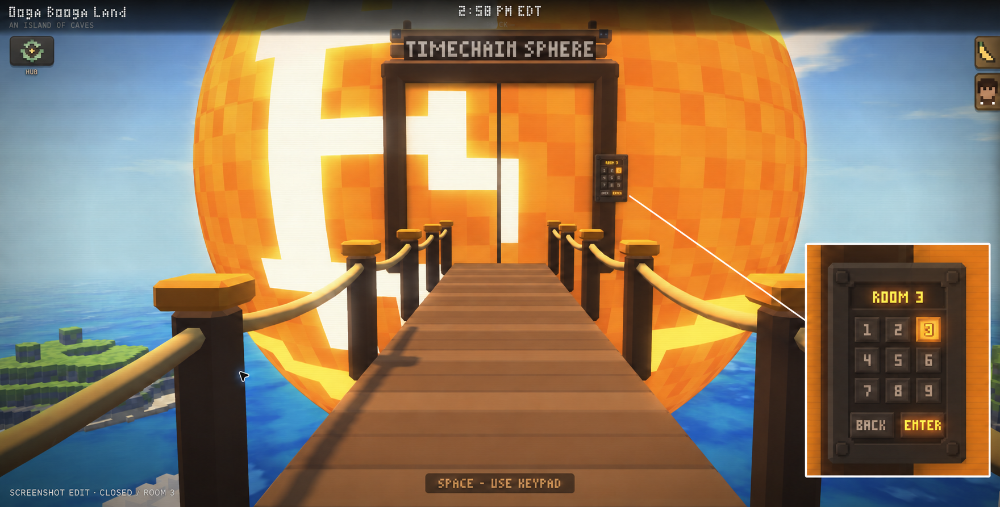
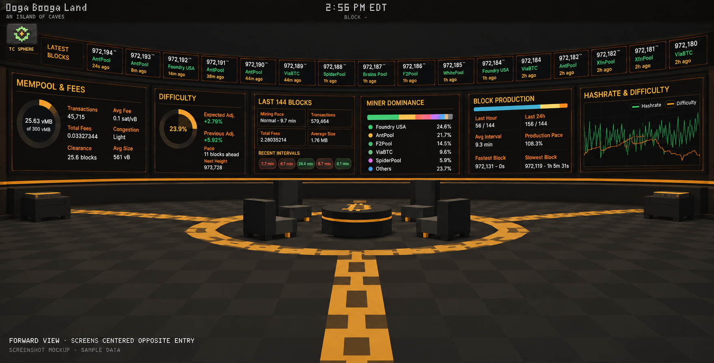
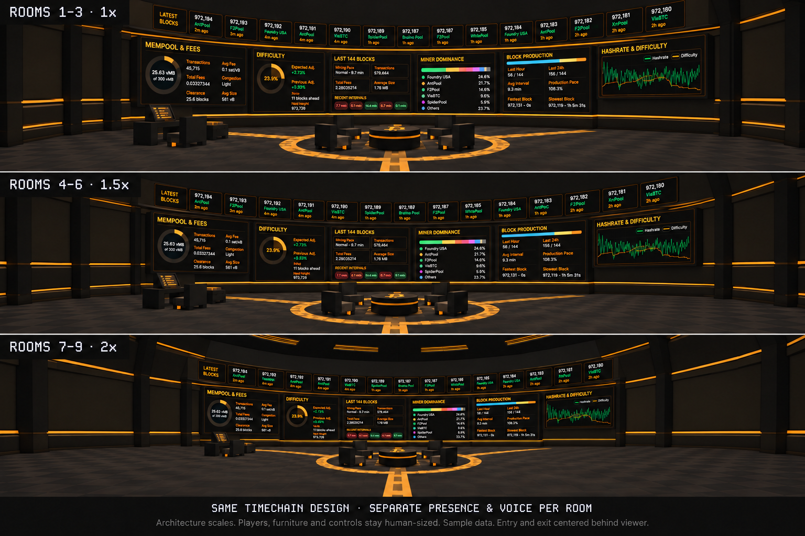
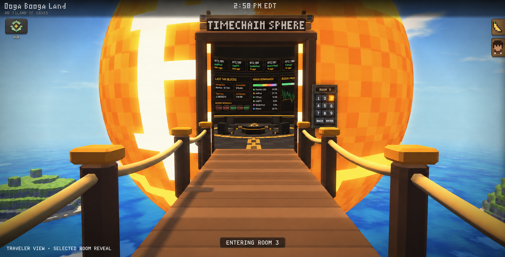
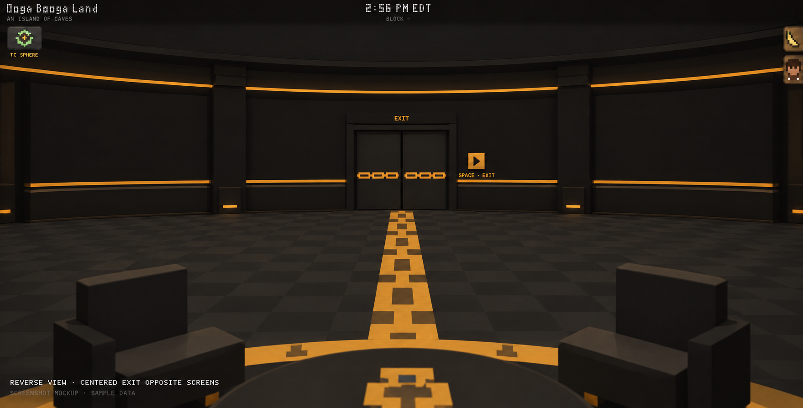

# Timechain Sphere implementation plan

Draft for [issue #235](https://github.com/OogaBoogaX/oogaboogaland/issues/235). This branch began with the agreed design, screenshot mockups and a verified data-source map; the frontend is now implemented against them.

## Status

Frontend, implemented:

| Part | Where |
|---|---|
| Nine rooms, `roomId` 1–9 validated at every boundary, 1× / 1.5× / 2× layouts with a fixed doorway, arrival, Exit button and chairs, and a table for 4, 8 or 12 | `src/js/timechain-rooms.js` |
| The shared room design (screens centred opposite the one doorway, latest-blocks ribbon, the ribbed dome, charcoal tiles with the amber chain from the doorway's seam to the ring round the table and out to the wall a third of a turn either side, the table and its chairs, the holdings desk against the left wall, Sani's corner beside the doorway, the doors under their EXIT header with the wall's strip carried across them as a chain, and the vestibule) | `src/js/timechain-room-models.js` |
| The room scene: first person only (`close.only` in `pilot.js`), no weapons or jetpack, guided arrival and exit, shared presence (`sphere-<id>`) or a solo copy, a table to jump on and chairs to sit in, Sani and his beer, local ambience, complete disposal | `src/js/scene-timechain.js` (always loaded), `src/js/timechain-interior.js` (deferred) |
| Block and mining data from mempool.space's public API: one in-flight request per dataset, backoff with Retry-After, hidden-tab pause, last good value kept as STALE, the 144-block window chained by parent hash, a page-wide cache shared by every room | `src/js/timechain-blocks.js` |
| Native charts in the Timechain Blocks look, each naming its source, window and freshness; the six holdings readings at the desk | `src/js/timechain-charts.js` |
| The exterior: doors whose outer faces carry the ball's turning pattern across their seam, the keypad, the dim passage and its curtain, the plug that stops tailgating | `src/js/timechain-models.js` |
| Physical keypad engagement in the Ooga's own first person, single selection, account resolution (selected number retries / Enter continues solo), the room readied only after Enter and a slice a frame, the reservation client, the turn to the doors, the walk through and a hand over without a fade from the same eye, the first-person walk back out, spectator doors | `src/js/timechain-gate.js`, wired in `src/js/scene-hub.js` |
| Routes `/sphere-1` … `/sphere-9`, reload and history (a stored visit repeats only as it was; a signed-in arrival without one goes to the keypad with the room chosen) | `src/js/routes.js`, `src/js/scene-timechain.js`, `prepare` in `src/js/director.js` |
| Hosted deferral: the interior's modules leave the hosted pages for one same-origin file fetched after Enter; the portable page keeps them inline | `data-defer` in `src/index.html`, `scripts/build.mjs`, `scripts/distribution-modules.mjs`, `src/js/deferred.js` |

Backend, still to do: the doorway reservation and transit messages in [doorway-contract.md](doorway-contract.md) (until the room advertises them, crossings run on the traveler's page alone), and regression coverage for nine-way voice isolation, stale pulls and reconnects. An authorized Timechain Index data proxy only if a key is configured.

Byte-level exception: the portable single file (`oogaboogaland.html`) and the source tree carry the interior's code inline, about 125 KB, because a file:// page has no second file to fetch. Hosted pages (`npm run site`, `npm run build:site`) do not.

## Experience

- Approach the physical keypad and press Space to focus it. Offer pointer/touch equivalents.
- The 3×3 keypad has digits 1–9, Back and Enter. Exactly one digit can be selected; selecting another replaces it. Start unselected with Enter disabled. Back/Escape cancels before crossing.
- Enter prepares only the selected destination, turns the view to the door, slides both leaves sideways, and guides the character in. Reveal the selected interior to the traveler. Swoop into first person, close the doors when clear and return movement.
- Every interior visit stays in first person and disables jetpack activation, including alternate controls and possession paths. Preserve gear/fuel and restore eligible exterior state on exit.
- Press Space at the physical Exit button to use the reverse guided track. No walk-through entrance or exit trigger.
- Exterior door faces continue the rotating sphere pattern. Interior door faces continue adjacent wall visuals across their seam.
- The shared entry/exit doorway is centered opposite the display wall, on the room's main axis. Entering players face the center of the screens, which wrap equally left and right. The doorway is behind them, never cut into the front display wall. The Exit button sits beside that centered doorway.
- Slow or failed preparation holds safely before passage, offers retry/cancel, and restores controls. Respect reduced motion and both renderers.

## Nine rooms and three sizes

| Rooms | Interior width, depth and height |
|---|---|
| 1–3 | 1× baseline |
| 4–6 | 1.5× baseline |
| 7–9 | 2× baseline |

Use one shared Timechain interior template. All nine may show the same data and reuse immutable assets; each signed-in room has independent membership, voice and soundscape lifecycle. Only the active room is instantiated. Keep exterior dimensions, avatars, eye height, movement speed, furniture and controls at their normal scale (the meeting table alone grows, to seat 4, 8 or 12). Larger variants expand the architecture and layout around a standard doorway and arrival area.

Use charcoal/black panels, fine amber borders and labels, white values, green mining data, a latest-block ribbon and native line/bar/donut charts, following [Timechain Index Blocks](https://timechainindex.com/blocks). Preserve the existing distribution/holdings readings and Sani/beer interactions in useful secondary views. Chart text must remain readable in the existing close-up/source modal.

## Spectators and the shared doorway

An outside observer sees the doors open and the traveler walk into a shallow, dim entrance passage. The avatar goes behind an occluder before the scene handoff; the doors then close. Only the traveler sees their selected room reveal. The exterior-owned passage contains no interior scene, live charts, occupants or room audio.

Normal movement always stops at the threshold for bystanders, even when doors look open. Only a player's own confirmed keypad/Exit flow permits the guided crossing. Show “Use keypad to choose a room” if they try to follow. Signed-in rooms remain public: intentionally selecting the same number is allowed.

Serialize only the short crossing with a server-owned, expiring doorway reservation. Do not reserve during keypad use or loading. Request after destination preparation; while busy, retain selection and show “Door in use · waiting” at a safe source-side point with Cancel available. Bound pending requests to one per player and the room's player capacity; recheck readiness/proximity and discard abandoned requests before granting.

The small transit contract needs a cycle ID, actor, direction, start time and expiry. It coordinates presentation; it is not a new authoritative physics engine. Release or expire cancelled/disconnected/stale cycles. Before scene commit, recover on the source side; after commit, settle at the valid destination. Never duplicate an actor or resume an expired crossing.

For exit, publish exterior zone `sphere` with a valid exterior pose behind the occluder, then reveal the walk onto the bridge. Disconnect voice through the scene handoff.

## Solo guest visits

Signed-out visitors get the same keypad, nine choices, sizes, camera rules and guided flow in a private local copy. The number chooses the template only. Two guests choosing 3, or a guest and a signed-in player choosing 3, never share occupancy.

Show “Solo visit · not signed in”. Do not register guest rooms, poses, transit events, occupancy, persistent identifiers, remote actors or voice; do not request a microphone. No `sphere-guest` network zone. Guest door cycles are local and do not contend with the shared doorway. Public charts and local ambience still work after entry.

Wait for account resolution before choosing shared versus solo mode, then keep the choice for the visit. Pending authentication is not confirmed sign-out. Late authentication/reconnect cannot publish a solo room. Sign-in returns to the exterior keypad for deliberate shared entry. Logout or session revocation inside immediately removes shared presence/voice and returns safely outside.

Account lookup failure must not lock the exterior controls or wait forever. After a bounded timeout, the physical selected number retries, Enter explicitly continues solo and Back returns to room choice. That choice keeps the visit local even if authentication later succeeds; it never silently enters a shared room.

## Network and resource boundaries

- Exterior zone: `sphere`; interior zones: `sphere-1` through `sphere-9`. Do not use dot suffixes: current grouping would merge their voice groups.
- Use `none` while handing off. Join a destination only with its valid arrival pose. Exact room filtering controls remote actors; stale SFU pulls must be rejected. Reconnect restores a shared active room only.
- Ambient sound is client-owned, as in DSB venues. Dispose it on departure; it may share audio assets across replicas.
- The hub owns shell, bridge, doors, keypad and bounded passage visuals. A separate interior scene owns its selected room, exclusive charts/data, audio, input and GPU resources.
- Approach, keypad focus, digit changes and Back load no interior-exclusive resources. Confirmed Enter can prepare code/preview; live datasets start on committed interior activation. Confirmed Exit may prepare the exterior handoff.
- Hosted delivery defers interior-only code. Preserve the portable single-file/file:// workflow with its documented download-byte exception. Keep strict CSP, vanilla JavaScript and existing shared account/donation services.
- Validate room IDs; preserve `/sphere`, interior history/reload state, meaningful source/freshness labels and complete cleanup.

## Data sources

See [data-contract.json](data-contract.json) for verified endpoint URLs, exact fields/units, sampled responses and uncertainties. The public Mempool APIs can support the requested chart families. They are equivalent data sources, not verified copies of Timechain Index's formulas. Attribute the actual provider.

The existing six `/OogaBooga/` endpoints describe holdings/distributions and cannot supply these block charts. Timechain Index's documented network API requires a key; never ship one in the client. Exact provider parity needs a confirmed public OogaBooga endpoint or a configured Worker secret/proxy and verified metric definitions.

Use an interior-scoped adapter with bounded caches, one in-flight request per dataset, abort/dispose, visibility pause, retry/backoff and last-good stale values. Do not start nine pollers or expand hub-only requests for these charts. Reuse existing global summaries only when units, freshness and semantics match.

Last 144 blocks is not a 24-hour window. Verify contiguous height/hash coverage before aggregates; keep hashrate and difficulty units separate. Pool share is attributed block share. The weekly pools response has no actual per-pool reward total; show unavailable until a complete source exists. Do not invent reward totals, “Fee Pressure” thresholds, “Mining Pace” categories, or missing history.

## Work split

**Opus frontend:** native room design/charts, all scale variants, keypad and doors, camera/jetpack policies, guided tracks, spectator presentation and collision gate, solo policy, room scene/resource lifecycle, hosted deferral and routes. Implement the interior data consumer against the explicit source contract. Coordinate the doorway event interface before integrating shared transitions.

**Backend:** implement the small authenticated reservation/transit contract and its expiration/reconnect behavior in the existing Durable Object; verify all nine voice groups and stale-pull authorization; document the guest non-registration rule. Add a credentialed data proxy only if an authorized Timechain Index source is configured. No idle server timers.

## Acceptance and verification

The issue body and latest comment contain the complete acceptance list. Also verify:

- Outside observers never fetch interior-exclusive data or render live room occupants.
- Open-door tailgating, two simultaneous entries and simultaneous entry/exit do not bypass interaction or mix room identities.
- Guests never join room/voice traffic; auth changes never silently convert solo to shared.
- All three room scales preserve usable controls, readable charts and valid collision/arrival paths.
- Data parsing preserves units, source windows, missing values, reorg handling and freshness.
- Two round trips leave no growing timers, input targets, GPU records, requests or audio nodes.
- Follow `AGENTS.md`: no dependencies or CSP weakening, no per-frame allocations. The explicit entry/exit camera animation is user-authorized. Default test mode is wait: build and syntax checks for runtime edits; run broader suites only when requested.

## Mockups

These are screenshot-based concept edits, not rendered implementation or live measurements. The new Timechain versions supersede the earlier blue interior. The entry image is the traveler's view; spectators see the dim passage described above.

### Closed doors and keypad

### Timechain interior

### Interior size groups

### Traveler entry

### Centered exit

